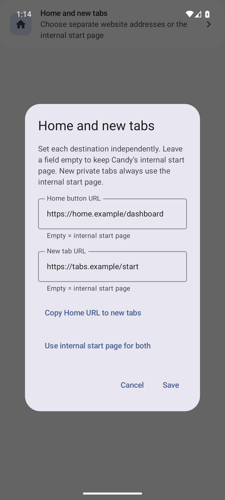
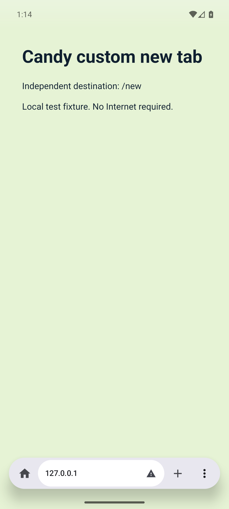
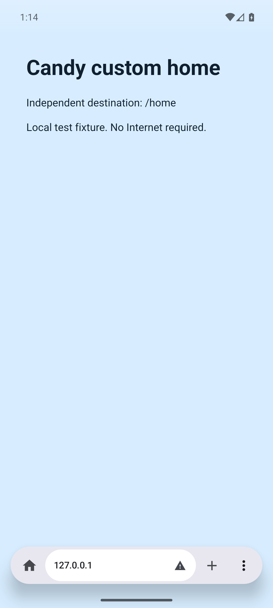

# Issue 350: configurable Home and new-tab pages

## Behavior

The existing internal start page remains the default for both destinations.
Browser → Startup → Home and new tabs now edits two independent website URLs.
Empty means internal. Saving validates HTTP(S), rejects credentials/unsafe schemes,
and persists both destinations together. Cancel/Back discard the draft; Copy and
Reset only change the draft until Save. English and German strings are provided;
other locales intentionally fall back to English, matching the existing resource convention.

Home navigates the current tab to its custom destination. Without a custom Home URL,
it retains the previous regular internal-tab reuse behavior. User-requested normal
tabs load their own URL without forcing the address editor. New private tabs remain
internal. Explicit links, engine/extension bootstrap, recovery and startup internal-home
presentation retain their existing routing. Launcher shortcuts and hardware/command
new-tab actions use the same user-tab policy.

## Actual UI evidence

Captured on a dedicated API 36 ARM64 emulator, using the real BrowserScreen and
local HTTP fixture pages. No external website or personal data is used. The browser
fixture waits for the requested URL, expected title, completed load, HTTP request,
and the rendered page's background pixel before capturing the two website images.

| Internal default retained | Settings with independent URLs |
| --- | --- |
|  |  |

| New-tab destination | Home destination, same selected tab |
| --- | --- |
|  |  |

## Verification and limitations

- Full and FOSS JVM suites: 2,314 tests each, no failures.
- Full/FOSS lint: zero errors or fatal findings; 697/700 warnings remain.
- Universal Full/FOSS debug APKs and Full instrumentation APK build successfully.
- Dedicated API 36 targeted matrix: eight tests, including real rendered navigation,
  repeated new tabs, internal defaults, private new tabs, explicit URLs, persistence,
  invalid saved inputs, Save/Cancel/Back, copy/reset, and startup regression.
- These are debug emulator checks, not physical-device or release-APK validation.
  Keyboard and launcher wiring were reviewed; the rendering test exercises toolbar actions.
- The first universal build ran out of disk space; after space became available it
  was rerun successfully. Only this task's generated intermediates were removed by this task.
- The first combined device/lint run timed out on the first fixture navigation.
  No production fix was inferred from that timeout. Isolated runs passed; the test
  now logs actual tab/request state on failure, allows a bounded cold-start window,
  and independently waits for real paint. The original timeout's exact cause is unproven.
- Initial parallel lint hit resource pressure; final lint is run serially with a
  temporary larger heap. The English fallback is narrowly declared on the ten new
  strings; no broader lint check is disabled.
