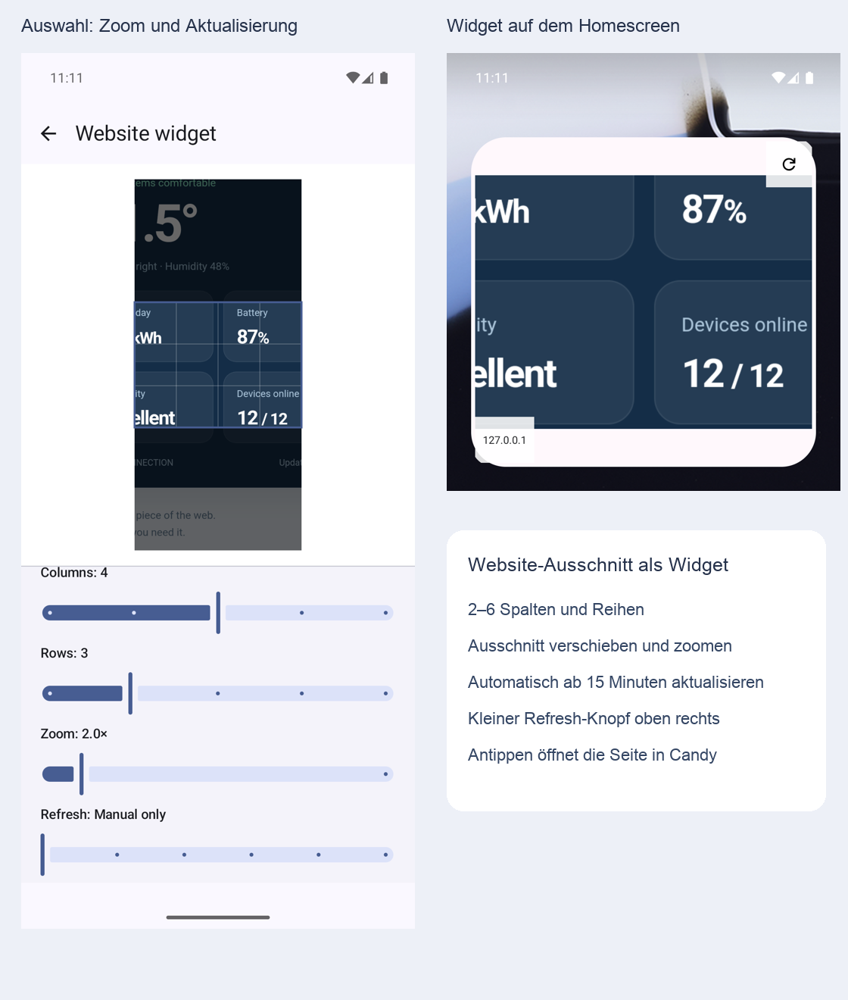

# Website widgets prototype

| User action | Behavior |
| --- | --- |
| Page menu → Website widget | Capture the selected page's visible engine viewport, without browser chrome |
| Choose columns and rows (2–6 each) | Constrain the crop to that aspect ratio and select the corresponding Android widget provider |
| Drag / pinch / zoom slider | Move the image and zoom under a fixed selection frame within the captured viewport |
| Add to home screen | Ask the launcher to pin the widget; the user confirms placement |
| Tap image | Open the original regular profile and source tab, or reopen the source URL if the tab no longer exists |
| Long-press widget → Reconfigure / Edit | The launcher's standard configuration action opens the existing Candy crop editor for that widget; format stays fixed |
| Refresh button (top right) | Reload the source in its original engine/profile, restore scroll and crop, then replace the image |
| Refresh interval | Manual only, 15/30 minutes, 1/3/6 hours; WorkManager scheduling is inexact under battery/network restrictions |
| Add from launcher's widget picker | Open a page in Candy, then tap the empty widget to configure it |
| Remove widget | Delete its binding and delete its capture once no other widget uses it |

## Prototype boundaries

| Concern | Contract |
| --- | --- |
| Website interaction | Android RemoteViews cannot embed GeckoView or WebView. The widget displays an updated snapshot and runs its refresh action on the homescreen. Website forms, links and scrolling open Candy. |
| Refresh | Temporary offscreen session using the original engine, profile jar, desktop mode and viewport; closed after capture. Failure retains the previous image. Legacy captures without engine/geometry require reselection. Redirects, unavailable/protected profiles and changed isolation are rejected. |
| Gecko refresh surface | The existing process-owned runtime creates a normal, policy-bound temporary session. Its `GeckoDisplay` renders into an RGBX `ImageReader` surface and captures pixels after the requested document finishes loading; no second Gecko runtime or foreground view is created. |
| System WebView refresh surface | An app-owned, private `VirtualDisplay` hosts the temporary same-profile WebView in an app-themed `Presentation`. This gives Chromium an attached hardware surface without a window on the user's main display. Capture waits for `postVisualStateCallback`, then uses `PixelCopy` on that private window. No MediaProjection, global whole-document drawing or activity launch is used. |
| Renderer lifetime | At most 20 seconds per attempt; cancellation closes the temporary session, display/surface and presentation. Image queues are drained while rendering. The returned bitmap contains only the bounded source viewport before the saved crop is applied. |
| Selection | Visible viewport rectangle, not a DOM-element anchor; scrolling or layout changes require reselection |
| Size | 25 grid-specific providers (2–6 rows and columns), preserving existing 4×3 and 4×4 component names; actual cell dimensions and padding depend on the launcher. Image uses fit-center to preserve the selected content. |
| Source identity | Tab, profile, document URL, navigation generation, session, attached view and view dimensions checked at capture; document identity rechecked before publication |
| Private content | Private, ephemeral, synced and protected-profile sources cannot be captured |
| Later profile protection / deletion | Invalidate saved captures and republish blank widget content when allowed profile ownership changes |
| Persistence | Bounded PNG and JSON in noBackupFilesDir, outside backup/sync/export. No cookies or page scripts exported. |
| Retention | At most 32 captures; unbound drafts expire after 24 hours and are pruned on the next save |
| Unsupported launcher pinning | Configure through the launcher widget picker instead |
| Launcher configuration | All grid providers declare optional initial configuration and standard reconfiguration. `SiteWidgetConfigurationActivity` validates the actual bound Candy provider, dispatches the existing editor action and returns the widget ID to the launcher; existing content stays valid while editing. Available long-press wording/actions depend on the launcher. |
| Platform | Android prototype; hidden from the shared/iOS feature menu |
| Localization | English and German prototype strings; other app locales fall back to English. MissingTranslation is suppressed only for this prototype resource file. |

## Ownership

| Concern | Owner |
| --- | --- |
| Crop geometry and source validation | `browser/sitewidget/SiteWidgetCropRules`, `SiteWidgetSnapshotRules` |
| Engine capture | `SiteWidgetCaptureRunner`, `BrowserController` wiring |
| Editor and lifecycle | `ui/SiteWidgetCropEditor`, `SiteWidgetEditorHost` |
| Atomic image/metadata/binding persistence | `data/SiteWidgetStore` |
| Pinning, replacement and launch | `SiteWidgetPublisher`, `SiteWidgetIntentHandler` |
| Standard launcher reconfiguration | `SiteWidgetConfigurationActivity`, `SiteWidgetConfigurationContract`, all grid provider metadata |
| Android rendering | `SiteWidgetProvider`, `SiteWidgetGridProviders`, `site_widget.xml` |
| Background refresh | `SiteWidgetRefreshScheduler`, `SiteWidgetRefreshWorker`, `SiteWidgetPageRenderer`, engine offscreen surfaces |
| Native refresh surfaces | `GeckoOffscreenSurface`, `SystemWebViewOffscreenSurface` |

## Verification

| Surface | Tests |
| --- | --- |
| Geometry, malformed crop/source inputs | `SiteWidgetCropRulesTest`, `SiteWidgetSnapshotRulesTest` |
| Fixed format and crop gestures | `SiteWidgetCropEditorInstrumentedTest` |
| Persistence, profile gates, binding cleanup and expiry | `SiteWidgetStoreInstrumentedTest` |
| Real Gecko/System WebView capture, reload, restored scroll, cookie isolation and private-mode rejection | `SiteWidgetCaptureInstrumentedTest`, `SiteWidgetPageRendererInstrumentedTest` |
| Shared menu capability and availability | `BrowserFeatureMenuRulesTest` |
| Installed provider sizes and removal of old widget pixels/metadata | `SiteWidgetProviderInstrumentedTest` |
| Optional configuration flags, standard editor dispatch and launcher result identity | `SiteWidgetConfigurationContractInstrumentedTest` |
| Launcher confirmation, same/cross-profile open and replacement | `SiteWidgetFlowInstrumentedTest` |

| Refresh renderer verified on API 36 | Result |
| --- | --- |
| Gecko reload changes page pixels and restores viewport scroll | Passed |
| System WebView reload changes page pixels and restores viewport scroll | Passed |
| Two System WebView profiles retain separate authenticated cookies | Passed |
| Private, protected, missing-profile and legacy sources issue no page request | Passed |

| OS-integration prototype verified on 2026-10-15 | Result |
| --- | --- |
| Full / Foss JVM suites | 1,955 tests each, passed |
| Shared JVM suite | 221 tests, passed |
| API 36 session-owned emulator | 65 relevant OS/Reader/store/UI checks, passed; real launcher pin/open/refresh/reselect included |
| Full / Foss debug builds and lint | Passed; lint has warnings, no errors |
| Neighboring download regressions | 28/30 passed; two existing native sandbox-anchor filename cases still return `download.png`. OS-feature checks above pass; the complete neighboring regression run is not entirely green. |

Android framework reference: [App widgets overview](https://developer.android.com/develop/ui/views/appwidgets/overview), [RemoteViews](https://developer.android.com/reference/android/widget/RemoteViews).
