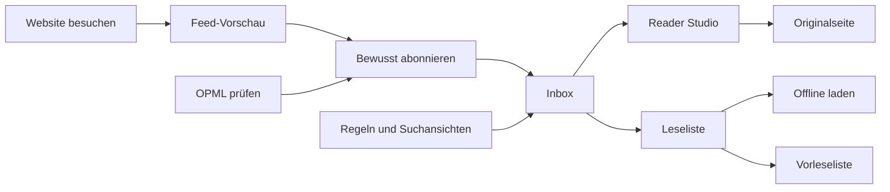
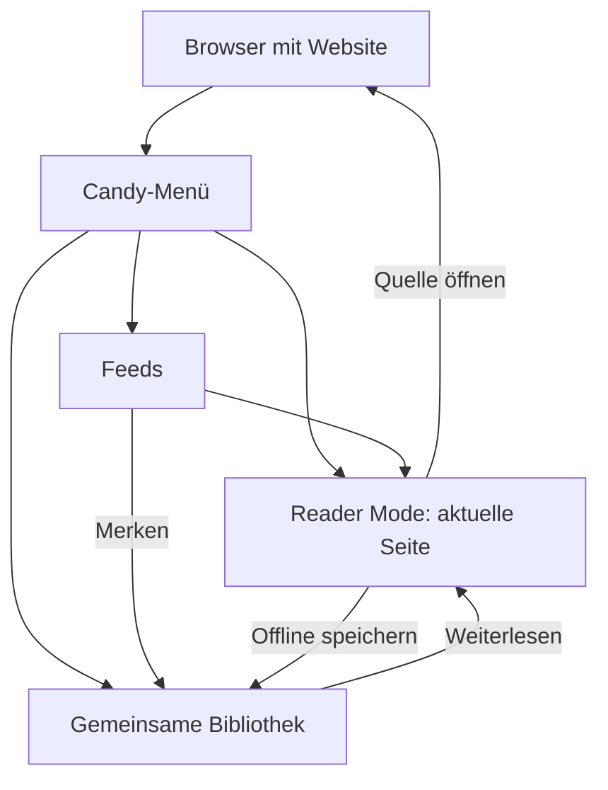

# Candy Browser, Feeds & Bibliothek — Produktentwurf

Stand: 22. Oktober 2026. Entwurf zur Abstimmung, keine implementierte App-Funktion.

| Einstieg | Inhalt |
| --- | --- |
| [Klickbarer Entwurf](entwurf.html) | Android-Vorschau, helle/dunkle Darstellung, interaktive Beispieldaten |
| [Ursprüngliches Konzept](index.html) | Bestehender erster Entwurf; unverändert erhalten |
| [Internationaler Quellenkatalog](entwurf.html#catalog) | Themen, Sprachwahl, Quellen-Vorschau; optional echte RSS-Amplifier-Suche |
| [Reader Studio](../../reader-studio/README.md) | Bestehende Reader-, Speicher- und Vorleseverträge |

## Ziel und Navigation

Eigene Quellen abonnieren, Nachrichtenflut begrenzen und ausgewählte Artikel in Ruhe lesen.
Feed-Erkennung bleibt im Browser-Seitenmenü. „Feeds“ öffnet abonnierte Quellen, „Bibliothek“ die gemeinsame Sammlung. Reader Mode bleibt als Aktion für die aktuelle Website erhalten.

## Internationaler Quellenkatalog — neuer Entwurf

Entdecken liegt unter **Quellen → Quellen hinzufügen**, zusätzlich über den Inbox-Einstieg.
**Feed-Adresse eingeben** steht zusätzlich direkt auf der Quellen-Seite und im Katalog bereit.
Dieser manuelle Weg benötigt keinen Katalogeintrag; Adresse, Ordner und simuliertes Abo sind klickbar.
Die bestehende Feed-Erkennung einer besuchten Website bleibt eine eigene Vorschau.
Dieser Ausbau ändert nur den HTML-Entwurf; keine Android-Integration, persistenten Abos oder Zahlungen.

| Oberfläche | Entscheidung im Entwurf |
| --- | --- |
| Einstieg | Eigene Entdecken-Ansicht mit typografischem Hero, Globus und Themenkacheln |
| Suche | Gefüllte Material-Suche, Suchsymbol, Löschen, explizites Absenden per Enter oder Pfeil |
| Themen | Technik, Wissen, Design/Kultur, Essen, Unterwegs, Natur als redaktionelle Einstiegsauswahl |
| Suchergebnisse | Tabs Alle Quellen / Blogs / Nachrichten; Themenchips horizontal in einer Zeile |
| Sprachen | Standard **Alle Sprachen** unabhängig von App-Sprache, Mehrfachauswahl im Sheet; Suche nach deutschen, englischen und muttersprachlichen Namen sowie Kürzeln |
| Quellenkarten | Name, Domain, Kurzbeschreibung, Sprache und Quellentyp; Vorschau statt sofortiger Abo-Aktion |
| Vorschau | Originaltitel, Beschreibung, letzte Beitragstitel, Originalseite, Ordnerwahl und Quelle abonnieren |
| Abo-Rückmeldung | „Eine gute Stimme mehr.“; anschließend weiter entdecken oder Quelle in Quellenliste finden |
| Fehler / leer | Wiederholen, andere Suchbegriffe, Sprachen erweitern; vorhandene Abos bleiben erhalten |
| Schrift / RTL | Originaltitel und Beschreibungen mit automatischer Textrichtung; UI bleibt in der gewählten App-Sprache |

### Beispieldaten und echte API

Standardmäßig zeigt der Entwurf ausdrücklich gekennzeichnete Beispieldaten einschließlich
beispielhafter Artikelüberschriften. Der Schalter **Echte RSS-Amplifier-Suche** außerhalb des
Telefonrahmens aktiviert optional echte, nur lesende Anfragen. Erst Absenden oder Themenwahl
startet die Suche; Umschalten allein sendet nichts. Suchtext wird nicht beim Tippen übertragen.
Kein API-Key, keine Cookies, kein persistenter Suchverlauf. Abos sind in beiden Modi nur simuliert
und gehen beim Neuladen verloren. Im privaten Demo-Tab sind Online-Suche und Online-Vorschau
gesperrt, Abos ebenfalls. Zurück/Navigation/Wechsel der Vorschau brechen laufende Anfragen ab.

| Geprüfter API-Zugang | Nutzung im Entwurf / Grenze |
| --- | --- |
| `GET /api/search?q=…&kind=blogs|news&limit=6&offset=…` | Zwei Quellentypen, keine Podcast- oder Videosuche. Verwendet Quellen aus `blogs`, nicht Beitragsresultate aus `posts`. |
| `GET /api/topics/{slug}?limit=16&offset=…` | Themenauswahl; auf Blogs/Nachrichten begrenzen. Redaktionelle Themenbezeichnungen sind Candy-Entscheidungen. |
| `GET /api/feeds/{slug}` | Original-Feed-Adresse, Sprache, Beschreibung, Status und letzte Beiträge. Höchstens vier parallele Detailabrufe. |
| Sprache | Kein bestätigter globaler Sprachfilter im API-Vertrag. Sprachwahl filtert ausschließlich geladene Quellen; UI kennzeichnet „Sprachfilter für diese Auswahl“. Weitere Quellen nachladbar. |
| Trefferzahlen | Zeigt nur tatsächlich geladene, gefilterte, nach Feed-Adresse deduplizierte Quellen. Keine vermeintlich vollständigen weltweiten Trefferzahlen. |
| Externe Daten | Als Text darstellen, HTML nicht ausführen. Nur HTTP(S)-Links ohne Zugangsdaten; Originalfeed statt Amplifier-Aggregationsfeed für späteres Abo. |
| Vorschau-Abbruch | Sheet-Wechsel, Escape und Zurück invalidieren ausstehende Antworten; alte Ergebnisse dürfen keine neue Oberfläche überschreiben. |

API und CORS am 22. Oktober 2026 im Browser überprüft. Für die App-Implementierung bleiben
Abdeckung/Qualität der Suchergebnisse, echte globale Sprachfilterung und Profilgrenzen zu lösen.
Auch der große Provider-Katalog ist keine Garantie vollständiger Abdeckung jeder Sprache.

Lokale Vorschau: `python3 docs/design-concepts/rss/preview_server.py` startet auf
`http://127.0.0.1:8770/docs/design-concepts/rss/entwurf.html#catalog`. Die bereits geöffnete
Vorschau auf Port 8769 verwendet denselben lokalen API-Relay. Er bindet ausschließlich an
Loopback, akzeptiert nur die drei oben genannten Endpunktfamilien und leitet nur Lesezugriffe
an den fest vorgegebenen Provider weiter. Keine fremden URLs, Cookies oder API-Schlüssel.
So bleibt die echte Suche unabhängig von den HTTPS-Einschränkungen des Vorschau-Browsers
testbar. Andere Hosts verwenden die öffentliche API direkt. Ist der Relay nicht gestartet,
funktioniert der Beispielkatalog weiter und Live-Suche zeigt den Fehlerzustand mit Wiederholen.

**Aus M3:** Search als gefüllte, abgerundete Oberfläche; Tabs für Inhaltskategorien;
Filterchips, Checkboxen für Mehrfachauswahl, semantische Farbrollen und Expressive-Bewegung.
**Candy-Designentscheidung:** Globusillustration, Themenauswahl, Kartenkomposition,
einzeilig scrollende Themenchips, Sprachwahl und Abo-Bestätigung. Maße und Komposition
des HTML-Telefons sind Vorschauwerte, keine neue normative Android-Designspezifikation.

Quellen: [RSS-Amplifier-API und Formate](https://rssamplifier.com/llms.txt),
[öffentliche API](https://rssamplifier.com/api/feeds), [Nutzungsbedingungen](https://rssamplifier.com/terms).

| Hauptbereich | Aufgabe | Unteransichten |
| --- | --- | --- |
| Inbox | Neue Beiträge sichten | Heute, Ungelesen, Gemerkt, Alle; Suche; Artikel |
| Bibliothek | Gespeicherte Webseiten und Feed-Artikel gemeinsam wiederfinden | Alle, Offline, Ungelesen, Gemerkt; Herkunft Webseiten/Feeds; Vorleseliste |
| Quellen | Abos verwalten | Ordner, neue Quelle, Feed-Einstellungen, Abrufstatus |
| Werkzeuge | Sammlung organisieren | Regeln, Suchansichten, OPML, Hinweise, Speicher |

## Browser-Integration und gemeinsame Bibliothek

Aktualisierter Entwurf: Reader Mode bleibt die Artikelansicht. Candy Feeds ist der Eingang für abonnierte Quellen. Die Bibliothek wird zur gemeinsamen Sammlung erweitert; vorhandene Reader-Speicherungen dürfen nicht verschwinden oder ein Feed-Abo voraussetzen.

| Oberfläche | Navigation im Entwurf |
| --- | --- |
| Website im Browser | Vorhandene schwebende Leiste: Tabs, Adresse, neuer Tab, ⋯; keine Feed-Tabbar |
| Browser-Menü | Bottom Sheet mit Adresse im Kopf, vorhandenen Shortcuts, neuen Einträgen Feeds/Bibliothek und Feed-Erkennung; normale Browserleiste währenddessen verborgen |
| Reader Mode | Vorhandener Reader-Einstieg bleibt; Artikelansicht mit URL-Pille, Aktionen im Sheet, Bibliothek erreichbar |
| Feeds | Eigener Bereich mit Inbox, Bibliothek, Quellen, Werkzeugen; Zurück am Einstieg führt zum Browser |
| Bibliothek direkt aus Browser | Gemeinsame Sammlung ohne Feed-Navigation; Zurück führt zur Website |
| Bibliothek aus Feeds | Derselbe Inhalt; Feed-Navigation bleibt für den Wechsel im Feed-Bereich verfügbar |
| Offline-Verwaltung | Verwaltet Downloads aus beiden Herkünften; Merkstatus und Download unabhängig |

| Ausgang → Ziel | Zurück-Verhalten |
| --- | --- |
| Browser → Menü | Menü schließen; Website unverändert |
| Browser → Reader | Gleicher Browser-Tab und vorherige Scrollposition |
| Browser → Feeds/Bibliothek | Gleicher Browser-Tab; keine künstlichen Web-History-Einträge |
| Feed-Liste → Reader | Gewählte Ansicht und Scrollposition erhalten |
| Bibliothek → Reader | Herkunftsfilter, Lesestatusfilter und Scrollposition erhalten |
| Reader → Bibliothek | Zur Reader-Sitzung zurück; bei schon vorher geöffneter Bibliothek keine doppelte Navigationsebene |
| Reader → Originalseite | Reader schließen; Quelle im Browser zeigen; Entwurf bietet Rückkehr zur Herkunftssammlung |
| Beliebiger Screen → Sheet | Zurück schließt zuerst das Sheet |

Die Schaltfläche **Android Zurück** außerhalb des Telefonrahmens simuliert System-Back. Der Pfad oberhalb des Telefons erklärt den aktuellen Bereich und gehört nicht zur späteren App. Browser-Tabs und Webseiten sind ausschließlich Demo-Inhalte.

| Bibliotheksdaten | Behandlung |
| --- | --- |
| Bisheriger Reader-Snapshot | Sofort in Bibliothek sichtbar, Herkunft Webseite, Zustand offline; kein Abo nötig |
| Nur gemerkter Feed-Beitrag | In Bibliothek, Herkunft Feed; erst nach erfolgreichem Download offline |
| Im Reader neu gespeicherte Website | Derselbe Artikel erscheint direkt in derselben Bibliothek |
| Gemerkt und offline | Merker entfernen löscht Download nicht; Download entfernen löscht Merker nicht |
| Historische Snapshots ohne Profil-Provenienz | Nicht still einem Profil zuweisen oder profilübergreifend freigeben; Migration/Bestandsansicht bei Umsetzung ausdrücklich klären |

**Bewusst neu:** gemeinsame Bibliotheksoberfläche und zusätzliche Menüeinträge. Bestehende Bookmarks/Favoriten und reguläre Downloads bleiben eigene Browser-Funktionen. Der Entwurf migriert keine echten Daten.

## Menü-Überarbeitung nach Feedback

| Entscheidung | Verhalten |
| --- | --- |
| Direkte Seitenaktionen zuerst | „Auf Seite suchen“, „Seite teilen“ und kontextuelle Feed-Erkennung stehen oberhalb der Sammlungen |
| Lesen & sammeln weiter unten | Feeds und Bibliothek folgen im scrollbaren Menüteil; keine zusätzliche „Erweitert“-Markierung |
| Kein separater Offline-Menüeintrag | Weder „Seite offline speichern“ noch „Offline gespeichert“ in diesem Browser-Menü; Speichern bleibt im Reader-Sheet, vorhandene Artikel in Bibliothek |
| Feed-Chip | Konkrete Zahl **ungelesener** Feed-Beiträge, z. B. „3 ungelesen“; keine unscharfe Gleichsetzung mit „seit letztem Besuch neu“ |
| Chip-Verhalten | Zähler reagiert auf Lesen und Rückgängig; bei null kein Chip; Menüeintrag öffnet „Ungelesen“ |
| Eigene Abläufe | Am Ende des scrollbaren Inhalts, nach Lesen & sammeln; im Entwurf einklappbar und ohne erfundene konfigurierte Abläufe |
| Fester Menü-Footer | Browser-Aktionen Zurück/Vorwärts/Neu laden/Favorit/Anheften bleiben unten fixiert |

## Vollständiger Funktionsumfang

| Funktion | Verhalten | Abnahme für spätere Implementierung | Etappe |
| --- | --- | --- | --- |
| Feed-Erkennung | RSS/Atom auf aktueller HTTP(S)-Seite entdecken; manuelle Adresse als Alternative | Vorschau vor Abo; vorhandenes Abo erkennen; ungültig/leer/Netzfehler unterscheiden | 1 |
| Smarte Inbox | Heute, Ungelesen, Gemerkt, Alle; chronologische Reihenfolge | Zähler stimmen; gelesene Artikel ausblendbar; Scrollposition erhalten | 1 |
| Lesestatus | Einzelartikel, nächster ungelesener Beitrag, Sammelaktion | „Alle gelesen“ klar auf gewählten Umfang beziehen und rückgängig machen können | 1 |
| Ordner | Abos thematisch organisieren; beim Abonnieren zuordnen | Erstellen, umbenennen, verschieben, entfernen; Entfernen eines Ordners löscht keine Artikel ungefragt | 1 |
| OPML | Import-Vorschau; Abos und Ordner exportieren | Neue/vorhandene/ungültige Einträge unterscheiden; wiederholter Import erzeugt keine Doppelabos | 1 |
| Feed-Einstellungen | Feed-Inhalt, Reader-Volltext oder Originalseite je Quelle | Auswahl bleibt erhalten; bei fehlendem Volltext Feed-Text und Original-Link anbieten | 2 |
| Leseliste | Artikel für später merken | Merkstatus unabhängig von Gelesen-Status und Offline-Verfügbarkeit | 2 |
| Artikel-Tags | Artikel mit eigenen Begriffen ordnen | Tags hinzufügen/entfernen; Tag-Ansicht zeigt zugehörige Artikel | 2 |
| Offline-Pakete | Ausgewählte Artikel oder Leseliste herunterladen | Wartend/Laden/Bereit/Fehlgeschlagen unterscheidbar; Wiederholen und Entfernen möglich | 2 |
| Speicherverwaltung | Budget, WLAN-Option, bewusste Bereinigung | Nie Erfolg vor tatsächlichem Speichern; geschützte Artikel nicht still verwerfen | 2 |
| Vorleseliste | Android-TTS, Start/Pause, Reihenfolge, nächster Artikel, Geschwindigkeit | Artikelposition und Warteschlange konsistent; fehlende Stimme behandeln | 2 |
| Regeln | Bereich → Bedingung → Aktion; Treffer-Vorschau | Lokal auswerten; aktivieren/pausieren/löschen; ausgeblendete Inhalte wieder auffindbar | 3 |
| Suchansichten | Begriff + Ordner/Quelle + Gelesen-Status speichern | Anlegen, bearbeiten, umbenennen, löschen; neue Treffer erscheinen automatisch | 3 |
| Dubletten | Identische Artikel-URLs zusammenführen; ähnliche Titel gruppieren | Quellen bleiben zugänglich; verschiedene Artikel nicht allein wegen ähnlichem Titel löschen | 3 |
| Gezielte Hinweise | Gewählte Quellen oder Regel-Treffer | Standard aus; Berechtigung berücksichtigen; keine Vorschau aus gesperrten Profilen | 3 |
| Tageszusammenfassung | Gesammelte neue Beiträge zu gewünschter Zielzeit | Ruhezeiten; verpasste Ausführung; systembedingt verzögerte Zustellung berücksichtigen | 3 |
| Artikeländerungen | Aktualisiert-Hinweis und Textvergleich | Nur gespeicherte Vorversion vergleichen; Lesestatus nicht ungefragt zurücksetzen | 3 |
| Newsletter | Empfangsadresse/Dienstanbindung, Absenderverwaltung, Feed-Darstellung | Eigener Plan für Empfang, Spam, Löschen und Datenschutz | 4 |
| Podcasts | Audio-Abos, Downloads, Abspielposition, Hintergrundwiedergabe | Eigene Mediensteuerung, Speicher- und Plattformverträge | 4 |
| Gerätesync | Abos, Ordner, Merker, Lesestände und optional Regeln synchronisieren | Profilgrenzen, Löschungen, Konflikte und Offline-Änderungen spezifizieren | 4 |

## Vorschläge zur Abstimmung

Diese Werte sind Produktvorschläge, keine bestehenden Zusagen oder zwingenden Voraussetzungen für den Entwurf.

| Entscheidung | Vorschlag | Grund / Alternative |
| --- | --- | --- |
| Eigentümerschaft | Abos pro normalem Browserprofil | Passt zu Candy-Profilgrenzen; geräteweite Sammlung wäre Alternative |
| Private Tabs | Vorschau erlauben, dauerhafte Abos/Lesespuren/Downloads verhindern | Explizit gespeicherte Sammlung nur aus normalem Profil |
| Aktualisierung | Beim Öffnen; periodischer Abruf opt-in | Vermeidet überraschenden Daten- und Akkuverbrauch |
| Hinweise | Standardmäßig aus | Quelle/Regel gezielt wählen, alternativ Tageszusammenfassung |
| Offline-Budget | 250 MB als einstellbarer Startwert | Größenbudget statt starrer Artikelzahl; heutige 20-Snapshot-Regel nicht still ändern |
| Bereinigung | Ungemerkte ältere Downloads zuerst; Merker schützen | Bei vollem Budget Entscheidung anbieten; kein unbegrenzter Speicher |
| Volltext | Feed-Volltext bevorzugen; Extraktion nur bei Bedarf | Pro Quelle überschreibbar, Originalseite immer erreichbar |
| Hintergrund-Audio | Separates Paket nach Vorleseliste | Existierende Android-TTS-Sitzung trägt diesen Vertrag noch nicht |
| Sync | Candy Sync als Integrationskandidat prüfen | Kompatibilität nicht voraussetzen; kein paralleles Kontensystem ohne Bedarf |

„Profil Privat“ in der Vorschau meint ein normales persönliches Profil. Der private Browsermodus ist ein eigener, flüchtiger Zustand.

## Zustände und Übergänge

| Situation | Sichtbares Verhalten |
| --- | --- |
| Keine Abos | Quelle hinzufügen oder OPML importieren |
| Alles gelesen | Ruhiger Leerzustand; keine Pflicht zum weiteren Konsum |
| Abruf läuft | Vorhandene Artikel bedienbar; Status am Abruf |
| Einzelne Quelle defekt | Fehler an Quelle, letzter Erfolg sichtbar, gezielt erneut versuchen |
| Offline | Vorhandene Inhalte weiter lesen; nicht geladene Inhalte entsprechend kennzeichnen |
| Volltext scheitert | Feed-Inhalt behalten, Originalseite anbieten |
| Download teils fehlgeschlagen | Erfolgreiche Downloads behalten, nur Fehler wiederholen |
| Benachrichtigung verweigert | Einstellung behalten, fehlende Systemberechtigung erklären |
| Vorversion fehlt | Aktualisierungszeit zeigen; keinen Textvergleich erfinden |
| Quelle bereits abonniert | Bestehendes Abo öffnen, kein zweites Abo erstellen |
| Profilwechsel während Laden | Alte Antworten nicht in neues Profil übernehmen |

## Anbindung an Candy

| Bestehender Vertrag | Konsequenz |
| --- | --- |
| Reader: flache Papierfläche und URL-Pille mit ⋯ | Kein RSS-Header und keine zusätzliche obere Toolbar im Artikel; Aktionen im Sheet |
| Reader-Fortschritt und Schrift-/Theme-Auswahl vorhanden | Gemeinsame Oberfläche wiederverwenden |
| Android-Bibliothek derzeit 20 neueste Snapshots | Feed-Retention separat entwerfen; bestehende Reader-Daten kompatibel halten |
| Android-TTS an Reader-Sitzung gebunden | Vorleseliste über neuen fokussierten Sitzungsinhaber; Hintergrundwiedergabe separat |
| iOS-Bibliothek aktuell nur im Sitzungsspeicher; TTS nicht verfügbar | Android-Entwurf nicht als bereits zugesagte iOS-Parität darstellen |
| Private Speicherung untersagt | Regeln, Merker, Suchansichten und Lesestände ebenfalls an Privatgrenze prüfen |
| Reader-Sanitization und URL-Policy vorhanden | Feed-HTML, Links und Downloads durch bestehende Grenzen führen |
| Große Controller dienen Orchestrierung | Parsing, Identität, Regeln und Retention in fokussierte Modelle/Rules; keine neue Logikmasse in BrowserController |

## Umsetzungspakete und Prüfungen

| Paket | Technische Schwerpunkte | Erforderliche Prüfungen |
| --- | --- | --- |
| 1 · Basis | Feed-Identität, RSS/Atom-Parsing, Discovery, Profil-Repository, Gelesen-Status, OPML | Full/Foss-Unit-Tests; instrumentierte Discovery-, Speicher-, Privatmodus- und Inbox-Flows |
| 2 · Lesen | Reader-Übergabe, Volltext-Fallback, Merker/Tags, Offline-Budget, TTS-Queue | Identität bei Navigation/Profilwechsel; echte Persistenzfehler; Offline und TTS-Lifecycle auf dediziertem Emulator |
| 3 · Fokus | Deterministische Filter/Dubletten, Suchindex, begrenzte Revisionen, Hintergrundabrufe/Hinweise | Filtervorschau = Auswertung; keine Titel-Leaks; fehlende Berechtigungen und verzögerte Jobs |
| 4 · Verbindungen | Separate Specs für Newsletter, Podcasts und Sync | Jeweilige Server-, Medien-, Konflikt- und Plattformtests |

Jede Android-Testsession verwendet ihren eigenen API-34+-Emulator und expliziten Geräteserial. Ressourcen-/Buildänderungen zusätzlich mit Full/Foss-Lint und Assemble prüfen. In diesem Entwurf werden keine App- oder Gerätetests ausgeführt.

## Design und Prototyp-Grenzen

| Bereich | Festlegung |
| --- | --- |
| Aus M3 | Farbrollen für Oberfläche/Container/Primary; betonte Typografie; Navigation mit vier beschrifteten Zielen; Aktionen im Bottom Sheet |
| Eigene Entwurfsentscheidungen | Candy-nahe violette/rosafarbene Palette, Nunito-Vorschau, Abstände, Telefonrahmen, Artikeltexte und Bildschirmzuschnitt |
| Android-Umsetzung | Bestehendes MaterialTheme, lokalisierte Strings, Shapes und Motion verwenden; HTML-Pixelwerte nicht unverändert nach Compose kopieren |
| Große App-Fenster | Navigation Rail und Liste/Detail vorsehen; Desktop-Entwurfsseite selbst zeigt absichtlich eine Telefonvorschau |
| Zugänglichkeit | Fokus sichtbar, Icon-Aktionen beschriftet, Text nicht nur über Farbe unterscheiden; Schriftvergrößerung in Compose prüfen |
| Funktionierende Demo | Navigation, Merker/Gelesen/Rückgängig, Suche, Suchansichten, Ordner, Einstellungen, Offline-Status und Queue im Arbeitsspeicher |
| Simuliert | Feed-Abrufe, Import/Export, Downloads, Regeln auf neue Beiträge, Audio, Hinweise, Artikeländerungen und externe Verbindungen |
| Daten | Ausschließlich Beispielinhalte; keine echten Netzwerkaufrufe, dauerhafte Speicherung, Systemberechtigungen oder Audiodateien |

## Inspirationsquellen

| Produkt | Übernommene Idee |
| --- | --- |
| [NetNewsWire](https://netnewswire.com/) | Smarte Ansichten, Ordner, OPML |
| [Inoreader Filter](https://www.inoreader.com/features/filters) | Explizite Bedingungen, Dubletten |
| [Inoreader Ordner und Tags](https://www.inoreader.com/features/folders-and-tags) | Quellenorganisation und Artikelmarkierung trennen |
| [Feedbin](https://feedbin.com/home) | Volltext, Aktionen, Artikeländerungen, spätere Newsletter/Podcasts |
| [Feedbin Suchansichten](https://feedbin.com/help/saved-searches/) | Wiederkehrende Suchen speichern |
| [Readwise Reader](https://docs.readwise.io/reader/guides/workflows/library-configuration) | Bewusste Auswahl für späteres Lesen |
