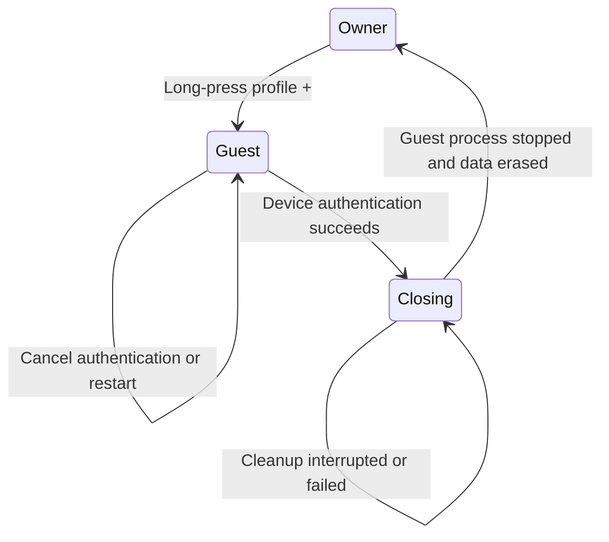

# Guest Bubble

## User behavior

| Action | Result |
| --- | --- |
| Enable Guest Bubble in Settings → Tabs & gestures | Shows a three-step tutorial before activation. Requires profiles and an available strong biometric or device screen lock. Disabled by default. |
| Tap profile + | Opens the existing profile creation flow. |
| Long-press profile + while enabled | Locks the owner's Candy surfaces and opens a separate guest session. The long-press action updates immediately after changing the setting. |
| Browse as guest | One temporary page with address/search input, back navigation and an End guest session action. No owner profiles, history, favorites, extensions, settings or app bridges. Search submits only explicit input; no suggestion requests. |
| End or press Back at the start of guest navigation | Requests Android system authentication. Strong biometrics or the device credential identify the owner; cancellation/error leaves the guest session locked. |
| Authenticate successfully | Persists Closing, stops the guest process, erases guest website data/cache, verifies removal, then releases the owner lock and returns to the existing owner browser. |
| Relaunch Candy, open a shortcut, Capsule or external URL during Guest Bubble | Returns to the guest session; the incoming owner navigation is discarded. |
| Guest process or device restarts | The durable lock remains. A new guest process erases the old guest data before starting a fresh guest page. |
| Cleanup fails or its process stops | Owner remains locked; reopening Candy resumes cleanup. Cleanup offers retry. |

## Ownership and storage

| Concern | Contract / owner |
| --- | --- |
| Runtime isolation | `GuestBubbleActivity` runs in `:guestBubble`. System WebView uses `guest_bubble` as its data-directory suffix before any WebView API is initialized. The guest browser uses System WebView independently of the owner's selected engine. No owner cookies or browser state are copied. |
| Owner lock | `GuestBubbleSessionStore` uses an atomic, bounded marker and a cross-process file lock under `no_backup/guest_bubble`. A corrupt or unreadable marker fails closed. Process death never releases it. |
| Cleanup | `GuestBubbleCleanupActivity` runs in `:guestCleanup`, outside the WebView process. Only a persisted Closing session permits cleanup. PID identities are validated; deletion never follows symbolic links. Only guest-specific paths are removed. |
| Persistence | Activation preference is separate from the runtime marker. Guest URLs, titles, cookies and page data never enter owner tab/history/Reader/Recall/sync stores. Android backup excludes the marker; Candy archive export/import also rejects it explicitly. |
| Android entry points | Explicit activity entry guards stop owner initialization and intent handling. `GuestBubbleGate` additionally shields existing owner windows and Recents, including separate Capsule tasks. |
| Public Candy surfaces | Document-provider queries reject owner profiles while locked; site widgets hide screenshots and stop authenticated refresh; device-search publication is hidden/revalidated. |
| Media | Owner playback and its system media session are paused/cleared on handoff; automatic PiP is blocked while the guest lock exists. Guest media requires a user gesture and has no Candy media service integration. |
| Settings and gesture | `GuestBubbleSettings` owns tutorial presentation; shared `ProfileSwitcher` adds an optional accessible long-press handler. Existing normal click and iOS defaults are preserved. |
| Localization | Guest Bubble resources cover all 29 declared app languages/scripts. Default and German resources are split by settings, browser and cleanup; other locales collect those same keys in `guest_bubble.xml`. |

## Limits

| Boundary | Behavior |
| --- | --- |
| Scope | Protects Candy's own browser surfaces, not Android or other apps. It is not device pinning or an Android guest user. Existing files exported outside Candy remain outside its control. |
| Guest integrations | Downloads, file uploads, camera/microphone/location permissions, external-app navigation and persistent browser integrations are unavailable. |
| Engine | Initial Android guest browser uses a standalone System WebView. It does not load the owner's Gecko extensions, Toppings or engine-specific protection configuration. |
| Platforms | Android feature. Shared profile-plus API remains optional for iOS. |

WebView process separation follows Android's [data-directory suffix contract](https://developer.android.com/reference/android/webkit/WebView#setDataDirectorySuffix(java.lang.String)).
