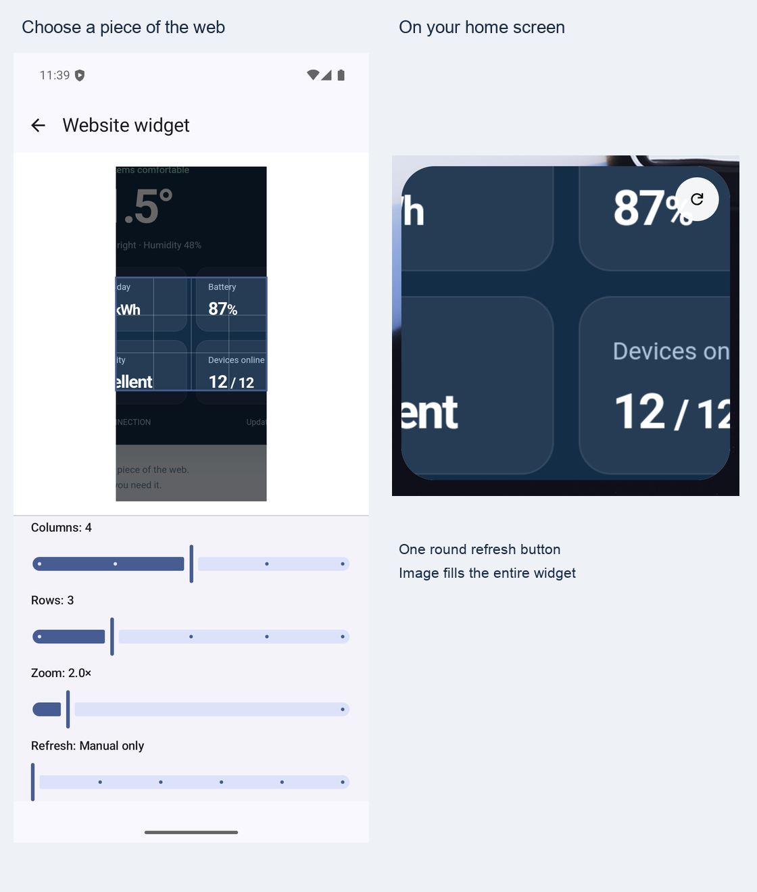

# Follow your feeds. Keep your ideas. Listen anywhere.

Candy Browser 0.48.0 brings feeds and saved pages into a shared library, adds a listening queue and optional offline voices, and lets you keep highlights and Markdown notes alongside the web. Personal search shortcuts, custom workflows, and FluxDown integration make everyday actions easier to repeat.

## Your reading, together

- Subscribe to RSS and Atom feeds, explore the international source catalog, or add a feed or website address yourself.
- Organize subscriptions in folders and saved articles with tags, and move subscriptions with OPML import and export.
- Save eligible articles for offline reading, bookmark them, or add them to your listening queue.
- Place a scrollable feed widget on your Android home screen and open articles directly in Candy.

Background refresh and notifications are opt-in. Some publishers do not allow usable article extraction; you can still open the original page. Private and protected content stays out of the widget.

Explore [feeds and the shared library](https://github.com/sk2andy/candy-browser/blob/v0.48.0/docs/feeds/README.md#topic-lookup).

## Keep listening

The article queue supports background listening with Android media controls and saved progress. Reader Studio and the queue share your voice choice.

- Choose Android voices or explicitly download an optional local voice model.
- Supertonic requires about 145 MB. Pocket TTS offers separate English, German, Italian, Portuguese, and Spanish packs of about 207 MB each.
- Pocket detects article language on your device and asks you to choose when the language is uncertain or its pack is missing.

Model downloads need a connection; local synthesis does not send article text to a voice service. Ordinary Reader playback still stops in the background; use the listening queue for background playback.

Learn more about [Reader Studio](https://github.com/sk2andy/candy-browser/blob/v0.48.0/docs/reader-studio/README.md#topic-lookup).

## Keep highlights and notes

Save a selected quote with a Markdown note, revisit it from the page's Highlights list, and jump back to a uniquely matching passage. The editor includes formatting controls and a preview. When Recall is enabled, saved quotes and notes can appear in its profile-local results.

Highlights stay within their profile and cannot be saved in private tabs. Changed or repeated text may prevent a highlight from reattaching; your saved quote remains readable.

> Highlights and notes are currently excluded from backup and sync. Exporting an app backup does not preserve them.

Find the highlight guide in [browsing documentation](https://github.com/sk2andy/candy-browser/blob/v0.48.0/docs/browsing/README.md#topic-lookup).

## Make repeated actions your own

- Create workflows with up to five actions: save offline, add a favorite, pin a tab, copy its URL, open Reader, or close the input. Assign them to supported menus, address actions, and Link Peek controls.
- Configure your own `!` search shortcuts and choose them through address-bar chips.
- Select FluxDown as an external download manager. Sharing cookies, user agent, and referrer has a separate, default-off setting; private downloads never share this session data.
- Authorized preview downloads now support files beyond APKs and continue after their preview closes.

If a workflow step fails, remaining steps stop; already completed actions remain. Private workflows reject persistent saves before starting.

See [browser actions, search, and downloads](https://github.com/sk2andy/candy-browser/blob/v0.48.0/docs/browsing/README.md#topic-lookup).

## Everyday improvements

- More reliable feed discovery, article return navigation, and home-screen widget sizing.
- Sharper landscape tab previews and more comfortable settings layouts on wide screens.
- Better protection around the status bar when page styles or late interactive banners compete with Candy's safe-area handling.
- Clearer download completion feedback and a simpler ongoing progress notification.

[All changes since v0.47.0](https://github.com/sk2andy/candy-browser/compare/v0.47.0...v0.48.0)
