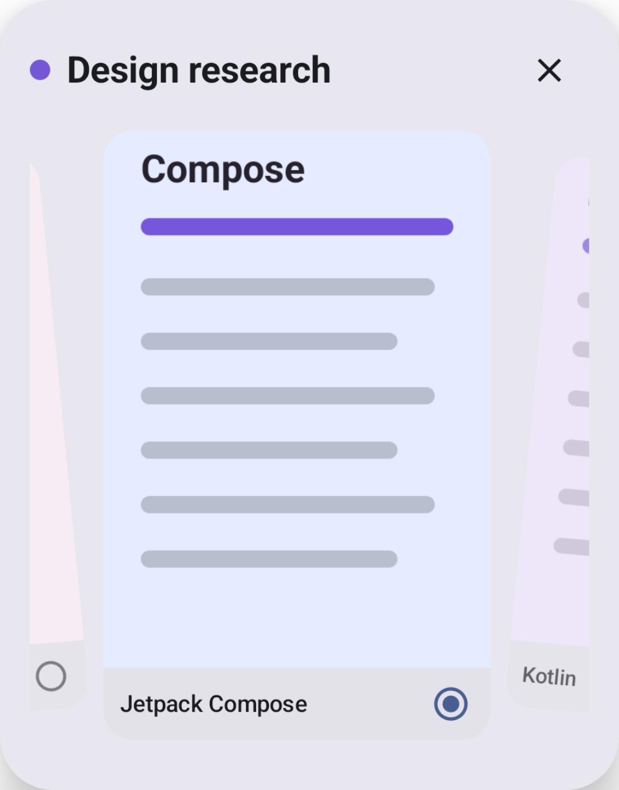

# Keep your tabs and feeds in reach

Candy Browser 0.49.0 makes it easier to get back to pinned tabs, keep related pages together, and catch up on a specific feed. It also adds native Mozilla Sync alongside Candy Sync.

## Find your pinned tabs and stay in the right stack

- Open the pinned-tab overview with a long press on the tab count or new-tab button, or add **Pinned tabs** to your address-bar actions.
- Choose how new tabs and links use stacks. Address-bar swipes stay in the current stack when stack-scoped switching is enabled.

See [tabs, profiles, and journeys](https://github.com/sk2andy/candy-browser/blob/v0.49.0/README.md#tabs-profiles-and-journeys).

## Catch up on a feed or folder

Open the RSS Inbox for the selected source or folder to focus on the articles you came for. Candy now also supports Android 12.

## Smoother browsing and downloads

- Pause and resume supported downloads and keep active Gecko transfers running in the background.
- Set your own Home and new-tab URLs. Choose when Candy hands supported links off to other apps.
- Get updated bundled content filters, improved add-on startup recovery, and better placement of page headers and full-height layouts near the system bars.
